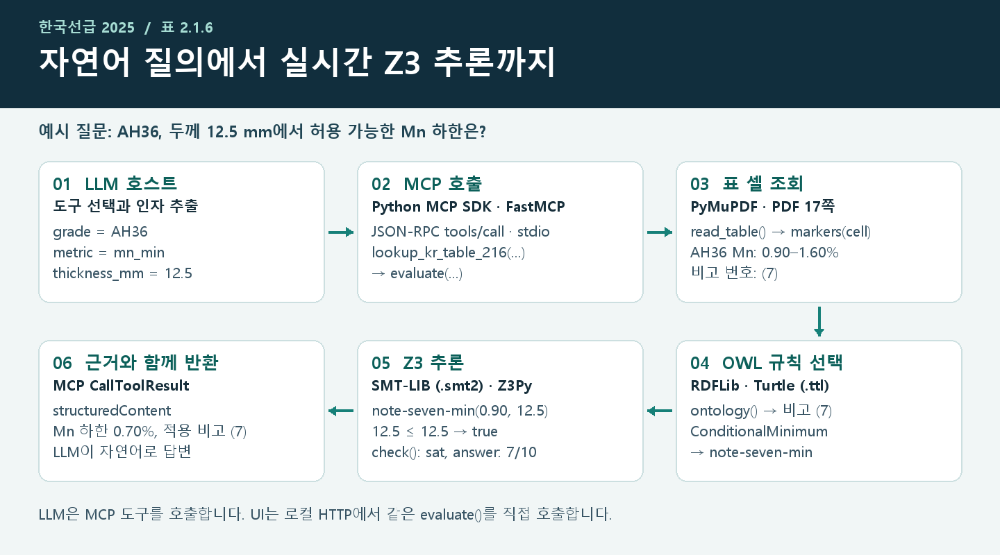
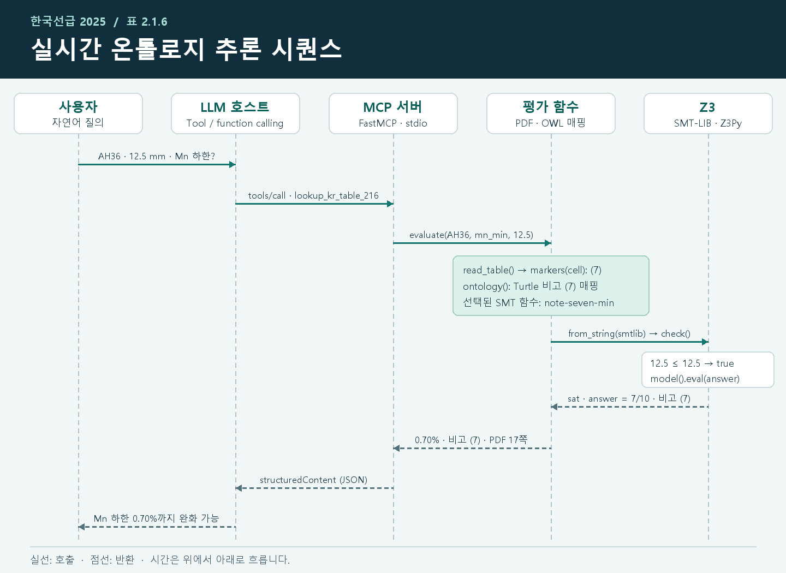

---
tags:
  - steel-ocr
  - ocr
---

# 한국선급 규칙 PDF 파싱

대상 문서는 [[data/2편_2025.pdf|한국선급 2025 선급 및 강선규칙 제2편 재료 및 용접]]입니다. 표 2.1.6은 PDF 17쪽(인쇄면 11쪽)에 있습니다. PDF에서 강종, C·Mn 셀, 병합 범위와 비고 번호를 읽고 비고 (4), (6), (7)을 적용합니다.

## 질의 시 온톨로지 추론



### 호출 시퀀스



1. LLM 호스트가 질문을 구조화해 `lookup_kr_table_216({"grade":"AH36","metric":"mn_min","thickness_mm":"12.5"})`를 호출합니다. B급 Mn 질의에는 킬드강 여부와 충격시험 실시 여부를 함께 전달합니다.
2. `evaluate()`가 `read_table()`에서 AH36의 병합 Mn 셀을 읽고, `markers(cell)`에서 비고 (7)을 찾습니다. `ontology()`는 이 번호를 OWL의 `ConditionalMinimum` 개체와 `note-seven-min` SMT 함수에 연결합니다.
3. Z3에 `(assert (= answer (note-seven-min 0.90 12.5)))`가 전달됩니다. `note-seven-applies`가 `(<= 12.5 12.5)`를 검사합니다. `solver.check()`는 `sat`, `model().eval()`은 `answer=7/10`, `applied_7=true`를 반환합니다.
4. 서버는 결과 수치와 원문 비고를 돌려줍니다. PDF 추출과 OWL 매핑을 재사용하며 Z3 계산은 질의마다 실행합니다.


### 실시간 호출에 쓰는 소프트웨어 스택

| 계층        | 기술과 형식                                                            | 실행 경로                                                                                                                            |
| --------- | ----------------------------------------------------------------- | -------------------------------------------------------------------------------------------------------------------------------- |
| 질의와 도구 호출 | LLM 호스트의 **tool/function calling**, MCP **JSON-RPC `tools/call`** | 호스트가 도구 이름과 JSON 인자를 선택합니다. MCP 클라이언트가 `lookup_kr_table_216`을 호출하며 서버와 **stdio**로 통신합니다.                                         |
| 도구 서버     | Python 3.12, MCP Python SDK **1.30.0**, **FastMCP**               | `src/mcp_server.py`의 `@server.tool()`이 도구를 등록하고, 함수가 `evaluate(...)`를 호출합니다. 반환값은 MCP `CallToolResult.structuredContent`로 전달합니다. |
| PDF 표 추출  | **PyMuPDF 1.28.2**, PDF 내장 텍스트와 표 좌표                              | `read_table()`이 병합 셀을 복원하고 `markers(cell)`이 비고 번호를 읽습니다.                                                                         |
| 온톨로지와 매핑  | **OWL/RDF**, **Turtle (.ttl)**, **RDFLib 7.6.0**                  | `ontology()`이 `ontology/table_216.ttl`을 파싱해 비고 번호와 클래스, 실행할 SMT 함수 이름을 찾습니다.                                                     |
| 산술과 조건 추론 | **SMT-LIB 2 (.smt2)**, **Z3Py / z3-solver 4.16.0.0**              | `ontology/table_216.smt2`의 규칙에 질의 값을 넣고 `Solver.from_string()` → `check()` → `model().eval()`을 실행합니다.                            |
| 로컬 비교 UI  | Python `http.server`, HTML/CSS, JavaScript `fetch()`              | `GET /api/cases/{id}`가 `evaluate(..., trace=True)`를 직접 호출해 실제 SMT-LIB와 모델 값을 표시합니다.                                              |

MCP 호스트에서 서버 실행 명령은 `.\.venv\Scripts\python.exe src\mcp_server.py`입니다. 호스트의 모델 도구 호출은 사용할 MCP 도구와 인자를 선택하는 단계이고, 규격서의 수치 판단은 서버의 Z3가 수행합니다. **MCP 호출과 Z3 반환은 검증했습니다.** 자연어에서 도구를 선택하는 LLM 호스트와 로컬 UI는 호출 진입점이 다릅니다.

## 질의 비교 UI

프로젝트 루트에서 실행한 뒤 브라우저로 [로컬 비교 페이지](http://127.0.0.1:8765)를 엽니다.

```powershell
.\.venv\Scripts\python.exe UI\server.py
```

페이지 중앙에서 표 2.1.6 원문 이미지를 볼 수 있습니다. 질의를 선택하면 표 본문 기준선과 비고를 적용한 Z3 결과를 다시 계산합니다. 저장된 LLM 결과가 있으면 같은 질의의 두 응답도 함께 표시합니다. 실행 상세에서 함수 호출, 규칙 조건, Z3 반환값, 실제 SMT-LIB와 PowerShell 재현 명령을 확인할 수 있습니다.

CLI에서 AH36 질의를 직접 재현할 수 있습니다.

```powershell
'{"grade":"AH36","metric":"mn_min","thickness_mm":"12.5"}' | .\.venv\Scripts\python.exe src\table_216.py --trace
```

- [[report/table_216_pipeline|표 2.1.6 파이프라인 및 벤치마크]]
- [[report/ontology|표 2.1.88 비고 (2) 온톨로지 별도 예제]]
