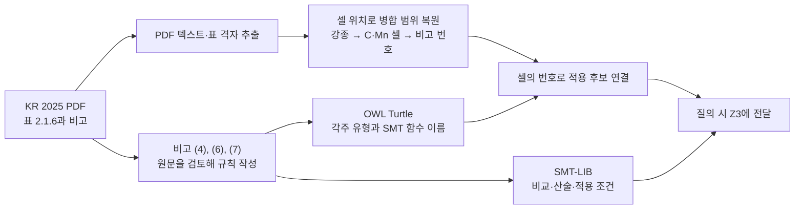
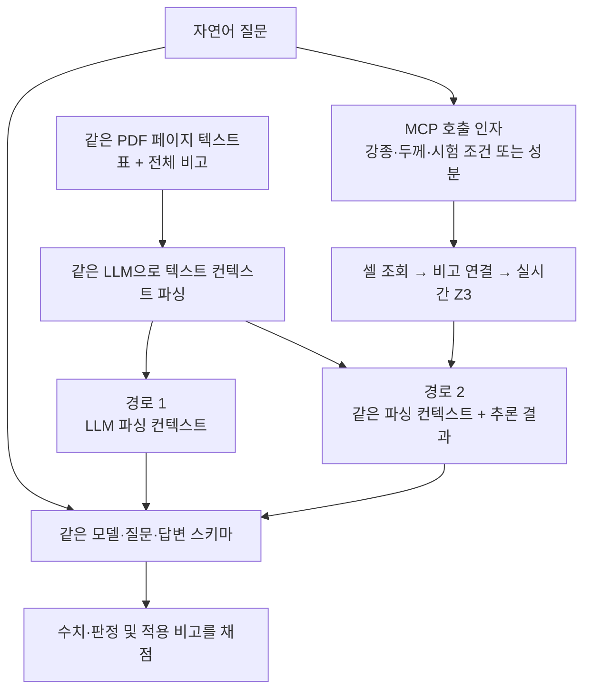

---
tags:
  - steel-ocr
  - ontology
  - benchmark
---

# 한국선급 표 2.1.6 파싱과 실시간 각주 추론

대상은 [[data/2편_2025.pdf#page=17|한국선급 2025 제2편, PDF 17쪽(인쇄면 11쪽)]]의 표 2.1.6 **탈산방법 및 화학성분(%)**이다. 이 실험의 평가 단위는 문자 인식률이 아니라 **수치 또는 판정이 정확하고, 실제 적용 비고를 정확하게 반환하는지**다.

실제 PDF를 읽고 실행한 기준선과 Z3 비교에서 수치·판정은 **6/12 → 12/12**, 비고 번호까지 포함하면 **5/12 → 12/12**였다. 아래 표의 기준선은 표 본문 조회다. 동일 LLM을 쓴 두 경로의 비교는 실행 스크립트에 포함되어 있으며, 이번 실행에서는 모델 인증이 실패해 점수를 집계할 수 없었다.

## 그림 1 · 온톨로지 구축과 PDF 사실 연결



`src/table_216.py`는 내장 텍스트가 있는 원본 PDF의 표 격자를 읽는다. 각 강종 행의 위치에서 C·Mn 셀이 차지하는 좌표를 찾아 병합 셀의 값을 복원한다. 예를 들어 AH36은 0.90–1.60%와 비고 (7)을 공유하고, FH36은 별도 셀의 0.90–1.60%를 사용한다. PDF 자체에서 재료기호와 셀 값·각주 번호 및 비고 본문을 읽는다.

`ontology/table_216.ttl`에는 `ConditionalMinimum ⊑ Footnote`, `JointLimit ⊑ Footnote`와 비고 개체를 선언했다. 각 개체의 번호와 SMT 함수 이름을 매핑한다. 실행 코드는 해당 클래스의 상위 클래스 선언을 확인하고, **PDF 셀에 표시된 번호와 OWL의 번호가 일치할 때** 규칙을 선택한다. `ontology/table_216.smt2`는 선택한 규칙의 조건과 계산을 맡는다. OWL은 이 예제의 명시적 클래스 선언과 매핑에 사용한다.

| 비고 | 실행 조건 또는 적용 범위 | 병합 방식 |
|---|---|---|
| (7) | Mn 셀에 (7)이 있고 두께가 12.5 mm 이하 | Mn 하한을 0.70%까지 완화 |
| (6) | Mn 셀에 (6)이 있고 킬드강이며 충격시험 실시 | Mn 하한을 0.60%까지 완화 |
| (4) | A급 강판의 C·Mn 셀에 (4)가 연결됨 | 표의 C 상한과 Mn 하한에 `C + Mn/6 ≤ 0.40%`를 함께 적용 |

## 그림 2 · 질문 시점의 두 경로



MCP 서버 `src/mcp_server.py`의 `lookup_kr_table_216`을 호출한다. 첫 호출에서 PDF와 온톨로지를 읽고 프로세스 내에서 재사용한다. 매 질의마다 해당 인자로 SMT 제약을 다시 구성하고 Z3를 실행한다. B급 질문에서 킬드강 여부 또는 충격시험 여부가 질문에 빠져 있으면 호출 전에 확인한다.

> **질의:** AH36의 두께가 12.5 mm이면 허용 가능한 Mn 최솟값은?

```json
{"grade":"AH36","metric":"mn_min","thickness_mm":"12.5"}
```

- 표 본문에서 읽은 컨텍스트: `AH36 | Mn 0.90–1.60% | 비고 (7)`
- 도구가 반환하는 컨텍스트: `AH36 | 12.5 mm | 허용 가능한 Mn 하한 0.70% | 적용 비고 (7) | 표 2.1.6, PDF 17쪽`
- 같은 두께의 FH36에는 비고 (7)이 연결되지 않아 0.90%를 반환한다.

MCP `stdio` 클라이언트로 AH36·FH36의 실시간 호출을 검증했다. 아래 자동 평가에서 MCP와 벤치마크는 동일한 `evaluate()`를 호출한다. 벤치마크는 자연어에서 인자를 추출하는 능력의 영향을 제거하기 위해 각 질의의 구조화 인자를 함께 제공한다.

## 실측 · 실제 PDF 12개 질의

| ID  | 질의 조건                          | 표 본문만 |         Z3 적용 | 적용 비고 |
| --- | ------------------------------ | ----: | ------------: | ----- |
| M01 | AH36, 12.49 mm, Mn 하한          | 0.90% |         0.70% | (7)   |
| M02 | AH36, 12.50 mm, Mn 하한          | 0.90% |         0.70% | (7)   |
| M03 | AH36, 12.51 mm, Mn 하한          | 0.90% |         0.90% | —     |
| M04 | FH36, 12.50 mm, Mn 하한          | 0.90% |         0.90% | —     |
| M05 | DH32, 10 mm, Mn 하한             | 0.90% |         0.70% | (7)   |
| M06 | B급, 20 mm, 킬드강·충격시험 실시         | 0.80% |         0.60% | (6)   |
| M07 | B급, 20 mm, 킬드강·충격시험 미실시        | 0.80% |         0.80% | —     |
| M08 | B급, 20 mm, 킬드강 아님·충격시험 실시      | 0.80% |         0.80% | —     |
| M09 | B급, 20 mm, 킬드강 아님·충격시험 미실시     | 0.80% |         0.80% | —     |
| C01 | A급 20 mm 강판, C 0.21%, Mn 1.20% |    충족 |            위반 | (4)   |
| C02 | A급 20 mm 강판, C 0.20%, Mn 1.20% |    충족 | 충족, 경계값 0.40% | (4)   |
| C03 | A급 20 mm 강판, C 0.20%, Mn 1.21% |    충족 |            위반 | (4)   |

| 경로                             | 수치·판정 정확 | 수치·판정 및 비고 정확 |   질의 중앙값 |
| ------------------------------ | -------: | ------------: | -------: |
| 표 본문 기준선                       |     6/12 |          5/12 | 3.801 ms |
| OWL 매핑 + Z3                    |    12/12 |         12/12 | 3.885 ms |
| LLM 파싱 + 동일 모델 QA              |      미측정 |           미측정 |      미측정 |
| 동일 LLM 컨텍스트 + Z3 결과 + 동일 모델 QA |      미측정 |           미측정 |      미측정 |

첫 PDF 추출은 855.808 ms였다. 중앙값은 PDF를 읽은 뒤 로컬 평가 함수에서 측정했으며 LLM 네트워크와 MCP 전송 시간을 포함하지 않는다. 질의는 비고가 적용되는 사례와 경계·비적용 통제 사례를 함께 골랐다. 결과는 표 2.1.6의 세 비고 범위에 해당한다. 원시 결과는 `data/table_216_benchmark.json`에 보관했다.

## 재현

프로젝트 루트에서 의존성을 설치하고 다음을 실행한다.

```powershell
python -m venv .venv
.\.venv\Scripts\python.exe -m pip install -r requirements.txt
.\.venv\Scripts\python.exe src/benchmark_216.py --output data/table_216_benchmark.json
.\.venv\Scripts\python.exe src/mcp_server.py
```

실제 LLM 비교는 `--llm-command`에 실행 파일과 인자를 전달한다. 실행기는 UTF-8 프롬프트를 표준 입력으로 받아 응답 본문만 표준 출력에 써야 한다. 모델 응답은 코드 펜스 없는 JSON 객체 `{"answer":0.70,"notes":[7]}` 형식이다. 예를 들어 인증된 Claude CLI가 있는 환경에서는 다음과 같이 실행할 수 있다.

```powershell
.\.venv\Scripts\python.exe src/benchmark_216.py --output data/table_216_llm.json --llm-command claude -p --model sonnet --tools= --strict-mcp-config --no-session-persistence
```

LLM 실행은 파싱 1회와 질의 24회로 구성한다. 같은 파싱 결과를 두 경로에 주고 경로 2에만 질의별 Z3 결과를 추가한다. 두 경로를 같은 모델로 실행하며 출력 스키마 위반은 오답으로 기록한다. 이번 환경의 Claude CLI 호출은 **401 OAuth 토큰 만료**로 실패했다.
